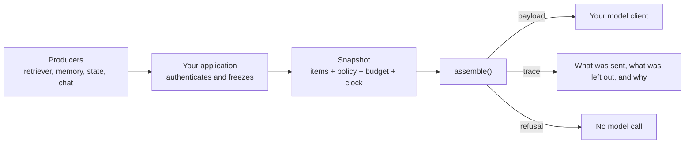

# assembler-python

[](https://github.com/contextwindowarchitecture/assembler-python/actions/workflows/ci.yml)
[](pyproject.toml)
[](https://contextwindowarchitecture.io/spec.html)
[](LICENSE)

Decide what your model sees, and keep a record of why.

assembler-python is the reference assembler for the [Context Window Architecture](https://contextwindowarchitecture.io) (CWA) specification. You give it everything that *could* go into a model request. It gives back the exact request to send and a trace of every decision. When the request would break your policy, it gives back a refusal instead, before any model is called.

## What is assembler-python

Most applications build a prompt by gluing strings together: a system prompt, some retrieved chunks, the chat history and the question. That works until something goes wrong. Then nobody can say which chunks were sent, which were dropped to fit the context window, or why a retrieved web page ended up next to the system prompt.

CWA treats the request as compiled output instead:

1. **Producers** (your retriever, memory store, account service, chat history) propose typed **items** for named **slots**.
2. **Your application** freezes those items, a versioned **route policy** and a **budget** into an immutable **snapshot**.
3. **The assembler** turns the snapshot into a **payload**, the exact bytes to send, and a **trace** that says what went in, what was left out and why. When the snapshot can't produce a request that meets the policy, the assembler returns a **refusal** with the trace instead.



`assemble()` is a pure function. It reads nothing outside the snapshot, so the same snapshot always yields the same bytes. You can store a snapshot and replay it later to debug an answer, review a policy change, or audit what a model was shown.

assembler-python **is not** a retriever, an LLM client, an agent framework or a prompt template library. It sits between the code that gathers context and the code that calls the model, and works with whatever you already use on either side.

## Status

assembler-python is a draft that tracks the CWA draft specification (`cwa/draft`), so the API and snapshot format can change before v1. The committed [conformance report](conformance-report.json) records the result for each published case, and [status.json](status.json) says what is claimed for each requirement and which tests back the claim. It is not on PyPI yet.

## Install

Install from the `draft-release` tag:

```sh
uv add "contextwindowarchitecture-assembler @ git+https://github.com/contextwindowarchitecture/assembler-python@draft-release"
# or
pip install "git+https://github.com/contextwindowarchitecture/assembler-python@draft-release"
```

The package imports as `cwa`. It requires Python 3.11 or newer, and its only dependencies are `jsonschema`, `referencing` and `rfc3339-validator`.

## Quickstart

A support bot gets a question. The retriever found two chunks, and only one of them is relevant.

```python
import json
from cwa import Snapshot, assemble

snapshot = Snapshot.freeze(
    assembly_time="2026-10-21T12:00:00Z",          # the clock, frozen like everything else
    scope={"tenant": "acme", "user": "u_42", "session": "s_1", "task": "support"},
    budget={"input": 8000, "reserved_output": 1024, "margin_percent": 10},
    profile=PROFILE,             # where each slot lands in the request
    route_policy=ROUTE_POLICY,   # which producer may write which slot, and each slot's rules
    tokenizer="estimate-utf8/v1",
    renderer="cwa-messages/v1",
    batches=BATCHES,             # what each producer proposed: instructions, two chunks, the question
    conflicts=[],
)
result = assemble(snapshot)

if result.refused:
    print("refused:", result.trace["refused"]["reason"])
else:
    request = json.loads(result.payload)   # {"system": [...], "tools": [...], "messages": [...]}

for row in result.trace["excluded"]:
    print(row["item_id"], row["reason"])   # kb:pricing below_threshold
```

[examples/quickstart.py](examples/quickstart.py) is the complete, runnable version, with the policy, the profile and the items written out:

```sh
uv run python examples/quickstart.py
```

```text
{
  "system": "Answer from the evidence only, and say so when it does not cover the question.",
  "messages": [
    {
      "content": "<evidence id=\"kb:refunds\">\nPro plans can be refunded in full within 30 days of purchase.\n</evidence>\n<query id=\"turn:1\">\nCan I get a refund on my Pro plan?\n</query>\n",
      "role": "user"
    }
  ]
}

62 tokens; left out:
  kb:pricing  below_threshold

refused: evidence_required, recovery: request_context
```

The example prints the request after mapping it for the Anthropic Messages API, so `system` is one string here rather than the renderer's list (see [Sending the payload to a model](#sending-the-payload-to-a-model)). The low-scoring chunk was left out, and the trace says why. When the retriever finds nothing, the route requires evidence, so the assembler refuses before any model is called. The trace then suggests what to do next.

A snapshot that is malformed, or breaks a rule the spec checks up front, raises `cwa.SnapshotError` with a list of `problems`. It produces no payload and no trace. A snapshot that names a tokenizer or renderer this package doesn't provide raises `cwa.UnsupportedComponentError` instead, because that isn't a flaw in the snapshot.

## Core concepts

| Term | What it is |
| --- | --- |
| **Item** | One piece of candidate context, such as an instruction, a retrieved chunk, a memory, a tool result or a chat turn. It carries its source, version, freshness, authority and trust alongside its body. |
| **Slot** | Where an item belongs: `governance.instructions`, `evidence.knowledge`, `interaction.history` and so on. Each slot has defaults for authority, protection and trust. |
| **Producer** | The component that proposes items, such as a retriever, a memory store or a state service. The route policy limits which slots it may write. |
| **Route policy** | Versioned rules for one route: which producers it accepts, relevance thresholds, caps, what to do about conflicts, and whether evidence is required. |
| **Placement profile** | Versioned layout: where each slot renders in the request (system, tools, or a tagged block in the user message). |
| **Snapshot** | Everything assembly may look at, frozen. Its digest (`snapshot.digest()`) is the replay key. |
| **Payload** | The exact bytes to send, written by a renderer. |
| **Trace** | Every item included, compressed or excluded, each exclusion with a registered reason code, plus any conflicts and the token count. |
| **Refusal** | No payload, a trace saying why, and, where one applies, a suggested recovery. |

The [specification](https://contextwindowarchitecture.io/spec.html) defines each of these precisely.

## Sending the payload to a model

The `cwa-messages/v1` renderer writes a provider-neutral request as JSON:

```json
{"system": [{"id": "...", "text": "..."}], "tools": [{"id": "...", "text": "..."}], "messages": [{"role": "user", "content": "..."}]}
```

Only governance items reach `system` and `tools`. Everything else, prior turns included, is escaped into a single user message. Mapping that onto a provider's SDK takes a few lines. The package doesn't ship them; [examples/quickstart.py](examples/quickstart.py) defines both, `to_anthropic` and `to_openai`, for you to copy:

```python
request = json.loads(result.payload)

# a separate system prompt, as in the Anthropic Messages API
client.messages.create(model=..., max_tokens=..., **to_anthropic(request))

# a system message, as in OpenAI Chat Completions and compatible servers
client.chat.completions.create(model=..., **to_openai(request))
```

If you use prompt caching, the optional `cwa-message-blocks/v1` renderer writes the same request, with the user message split into one `{id, text}` block per item. That lets you place a cache breakpoint at any item boundary.

## Framework-agnostic and compatibility

- **No framework or SDK lock-in.** The input is plain JSON (or keyword arguments of the same shape) and the output is bytes. Producers can be built on LlamaIndex, LangChain, a SQL query or a vector store; the [examples](https://github.com/contextwindowarchitecture/examples) use LlamaIndex for retrieval. The payload goes to whichever client you already use.
- **Small and typed.** It has three runtime dependencies, no network access and no model calls. The package ships `py.typed`, and the suite type-checks it with mypy.
- **Python 3.11 to 3.14.** CI tests every version in that range.
- **Byte-identical across languages.** The [TypeScript](https://github.com/contextwindowarchitecture/assembler-typescript), [Go](https://github.com/contextwindowarchitecture/assembler-go) and [Rust](https://github.com/contextwindowarchitecture/assembler-rust) assemblers pass the same conformance cases. A snapshot frozen in one service can be assembled, or replayed, in another. Output stays the same across processes, hash seeds, time zones and locales.
- **Built-in components.** Each one is named by id in the snapshot:

| Kind | Id | Use it for |
| --- | --- | --- |
| Tokenizer | `estimate-utf8/v1` | A portable estimate (UTF-8 bytes ÷ 4, rounded up) for models without a local tokenizer; pair it with `budget.margin_percent` |
| Tokenizer | `fixture-whitespace/v1` | Conformance tests only |
| Renderer | `cwa-messages/v1` | Chat-style model APIs |
| Renderer | `cwa-message-blocks/v1` | The same request with per-item blocks for prompt caching (optional in the spec) |
| Renderer | `fixture-xml/v1` | Conformance tests: one plain-text block, with no system channel |

For exact counts, pass your model's own tokenizer (see [Extending](#extending)).

## Security model

The assembler enforces the structural rules the spec gives it. It cannot see everything, so the "does not do" half of this section matters as much as the first.

**What the assembler enforces:**

- **Nothing outside the snapshot.** `assemble()` reads no network, files, environment or model, so a request can be replayed and audited from its snapshot.
- **Validation at the boundary.** A snapshot that fails its schemas or the spec's checks is rejected whole, and no payload is produced.
- **Producers stay in their lane.** The route policy lists which producer may write which slot, and a producer's kind narrows that further. For example, a retriever can only add evidence.
- **Authority comes from the slot, not the wording.** Only governance items render into the system and tools channels. Retrieved text, tool output, memory and user turns are escaped into the user message, so a chunk containing `</evidence><system>…` stays inert text. Untrusted authority is accepted only in tool results, memory and history.
- **Tools come from an allow-list.** A tool is offered only when the capability grant's producer, listed by the route, proposes it, and it is on the grant's allow-list.
- **Refusal before the model call.** A missing required slot, protected content that won't fit, an unresolved conflict or missing evidence produces a refusal, not a degraded prompt.
- **Pinned policy.** Profiles and route policies can be pinned by digest in a registry lock, so content can't change under an unchanged version. Deployments can be restricted to evaluated profiles.

**What it does not do:**

- **It doesn't authenticate producers.** Your application binds an identity to each batch. The assembler trusts that binding and checks only that the route lists the producer.
- **It doesn't detect or neutralize prompt injection.** Marking and separating untrusted content limits where that content can appear. It does not stop a model from following instructions written inside it.
- **It doesn't sanitize content or redact personal data.** Scope checks compare declared scope fields; they don't inspect bodies.
- **It doesn't check tool calls.** It decides which tools are offered. Checking each call before it runs is the application's job ([examples/04-tools](https://github.com/contextwindowarchitecture/examples/tree/main/04-tools) shows a guard).

## Extending

**Your own tokenizer.** Any object with an `id` and a `count(text)` method works. Pass it under its own id. That id can't be one the spec publishes, because a trace naming a published tokenizer must mean that tokenizer's count.

```python
class Chars:
    id = "my-chars/v1"
    def count(self, text): return len(text)

snapshot = Snapshot.from_json(document, tokenizers={Chars.id: Chars()})   # document["tokenizer"] == "my-chars/v1"
```

Load any data it needs, such as an encoding file or a vocabulary, before freezing, because `assemble()` reads nothing else. [examples/tiktoken_tokenizer.py](examples/tiktoken_tokenizer.py) is an exact adapter for OpenAI encodings.

**Your own renderer.** Pass any object that satisfies `cwa.render.Renderer` (an `id`, `profile_errors(profile)` and `render(occurrences)`) through `renderers=` in the same way. No published conformance case covers a custom renderer, so prefer a built-in one where you can.

**Pinned profiles and policies.** Load them through the registry, so an edit under an unchanged version is caught before it reaches a snapshot:

```python
from cwa.registry import Registry, lock

pinned = lock(profiles, route_policies)                     # or lock(new, existing=pinned) to add versions
registry = Registry.from_json(pinned, profiles, route_policies)
profile = registry.profile("support-chat-default", 1, deployment=True)   # evaluated profiles only
```

**Stage timings.** Lend `assemble()` a clock to get stage timings in the trace. Nothing the clock returns reaches the payload.

```python
assemble(snapshot, clock=time.perf_counter).trace["timings"]
```

## Examples

| Where | What |
| --- | --- |
| [examples/quickstart.py](examples/quickstart.py) | One request assembled, one refused, and the payload mapped onto provider SDKs |
| [examples/tiktoken_tokenizer.py](examples/tiktoken_tokenizer.py) | An exact tokenizer adapter, kept outside the pure core |
| [contextwindowarchitecture/examples](https://github.com/contextwindowarchitecture/examples) | Five runnable apps built on this assembler, from a help-center Q&A bot to a production-shaped agent with MCP tools, replay and evals |
| [contextwindowarchitecture/assembler-demo](https://github.com/contextwindowarchitecture/assembler-demo) | An inspector that runs the same question through all four assemblers and shows every decision |
| [contextwindowarchitecture/integrations](https://github.com/contextwindowarchitecture/integrations) | CWA placed inside existing systems |

## Documentation

| Read | For |
| --- | --- |
| [The specification](https://contextwindowarchitecture.io/spec.html) | What CWA requires, requirement by requirement (R-1 to R-26) |
| [Producer guide](https://github.com/contextwindowarchitecture/contextwindowarchitecture/blob/main/guides/producers.md) | How to write the items you put in a snapshot |
| [Assembler guide](https://github.com/contextwindowarchitecture/contextwindowarchitecture/blob/main/guides/assemblers.md) | How an assembler behaves, renderer by renderer |
| [docs/DESIGN.md](docs/DESIGN.md) | How this assembler is built, and the decisions behind it |
| [status.json](status.json), [conformance-report.json](conformance-report.json) | What is claimed for each requirement, and the result for each conformance case |

The docstrings of `Snapshot.from_json`, `assemble`, `SnapshotError` and `UnsupportedComponentError` give the exact rules for what is raised and when.

## Developing

```sh
uv sync
uv run pytest
```

Changes are made test-first, one behavior per commit. Schemas and conformance cases are vendored from the specification repository and never edited here. [CONTRIBUTING.md](CONTRIBUTING.md) covers the workflow, conformance and releases, and [AGENTS.md](AGENTS.md) holds the full rules.

## Other implementations

| Language | Repository |
| --- | --- |
| TypeScript | [assembler-typescript](https://github.com/contextwindowarchitecture/assembler-typescript) |
| Go | [assembler-go](https://github.com/contextwindowarchitecture/assembler-go) |
| Rust | [assembler-rust](https://github.com/contextwindowarchitecture/assembler-rust) |
| A new language | [assembler-template](https://github.com/contextwindowarchitecture/assembler-template) |

## License

Apache License 2.0. See [LICENSE](LICENSE) and [NOTICE](NOTICE). The vendored contract comes from the specification repository under the same license.
